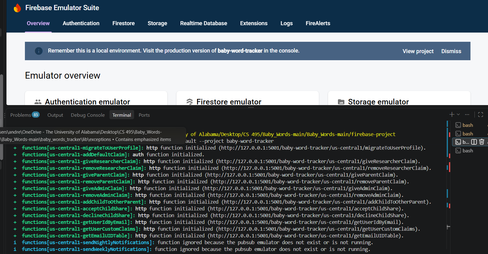

# Subissue 1 Invitation Workflow

## Emulator Retest

**Objective:** Retest the invitation workflow locally after the initial test was blocked by disabled Firebase billing.

**Test environment:** Flutter app on an Android emulator; Firebase Authentication (9099), Firestore (8081), and Cloud Functions (5001) emulators, using project ID `baby-word-tracker`.

**Test performed:** Started the Firebase Emulator Suite and confirmed that `addChildToOtherParent`, `acceptChildShare`, and `declineChildShare` initialized. Using the app, Parent A shared a child with Parent B and checked that the invitation was received.

**Result: PASS --** The child-sharing invitation workflow completed successfully when using the Firebase emulators. No Firebase billing upgrade was required.

**Evidence:** Screenshot showing successful initialization of the required Cloud Functions in the emulator terminal.

**Scope note:** This result verifies the local emulator workflow. It does not establish that the deployed Cloud Functions work while billing remains disabled.

